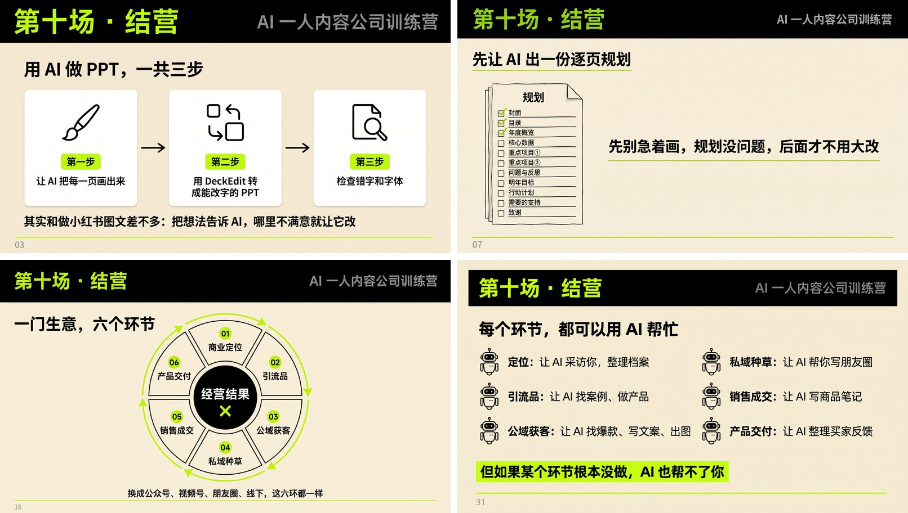

# 课程课件 PPT 制作 Skill

把一份讲稿，做成一整套 AI 画的课件，最后合成 PDF 和 PPTX。

这套方法来自「AI 一人内容公司训练营」十几场直播课件的实际制作：先规划框架，再逐页设计，先出 3 页样品，满意了再画全套。每一步你都能拍板。



## 先看这三点

- **只支持 Codex。** 出图靠 Codex 自带的画图能力。在 WorkBuddy 等其他工具里用，画图效果会差很多，不建议使用。
- **每页是一整张图。** 适合讲课投屏、发 PDF。字不能直接在 PPT 里改，需要改字时再用 DeckEdit、WPS 等工具转换。
- **会消耗 Codex 额度。** 一套 30 页左右的课件要画 30 多张图。

## 一键安装

**最简单：把这句话发给 Codex**

```text
请帮我安装这个技能：https://github.com/laughing-glitch/course-ppt-maker-skill ，技能在 skills/course-ppt-maker 目录。装好后告诉我装在哪里。
```

装好后**重新打开 Codex**，新技能才会生效。

**也可以用命令安装**

苹果电脑，打开「终端」，粘贴运行：

```bash
curl -fsSL https://raw.githubusercontent.com/laughing-glitch/course-ppt-maker-skill/main/install.sh | bash
```

Windows 电脑，打开「PowerShell」，粘贴运行：

```powershell
irm https://raw.githubusercontent.com/laughing-glitch/course-ppt-maker-skill/main/install.ps1 | iex
```

技能会装到 `~/.agents/skills/course-ppt-maker`。已经装过旧版本时，旧版本会自动备份到 `~/.agents/skill-backups`，不会直接删掉。

## 开始使用

新建一个文件夹，把讲稿放进去（Word、Markdown、PDF、txt 都行），在 Codex 里打开这个文件夹，发送：

```text
使用 course-ppt-maker，把这份讲稿做成一套直播课件。
```

Codex 会先问你几个问题：课程名、第几课、封面署名和日期、用不用默认风格。然后按下面的顺序推进：

1. **整体框架**：分几个部分、每部分几页，你确认。
2. **逐页设计**：每页写什么字、画什么，你确认。
3. **写提示词**：每页一段，风格统一。
4. **出 3 页样品**：你看风格和字号，不满意就改。
5. **画完全套**：逐页检查错字，哪页不满意就重画哪页。
6. **合成交付**：输出 PDF 和 PPTX。

想换风格，开始时附上几张你喜欢的 PPT 截图，说「参考这个风格」就行。

## 文件说明

```text
skills/course-ppt-maker/
├── SKILL.md                     流程和规则
├── references/
│   ├── style-default.md         默认风格：暖米白、黑色通栏、黄绿强调
│   ├── planning.md              框架和逐页设计的写法
│   └── prompt-template.md       提示词模板和示例
└── scripts/build_deck.py        把图片合成 PDF 和 PPTX
```

## 许可

MIT。欢迎自用和分享，转发时请保留本仓库链接。
